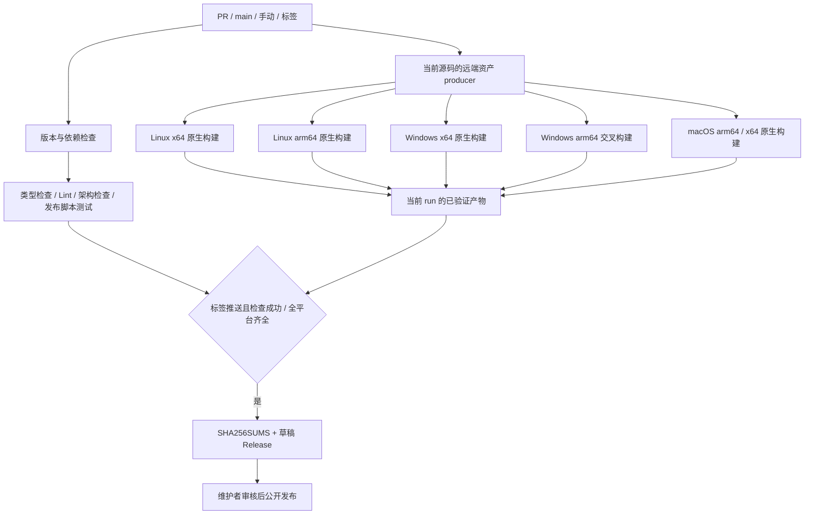
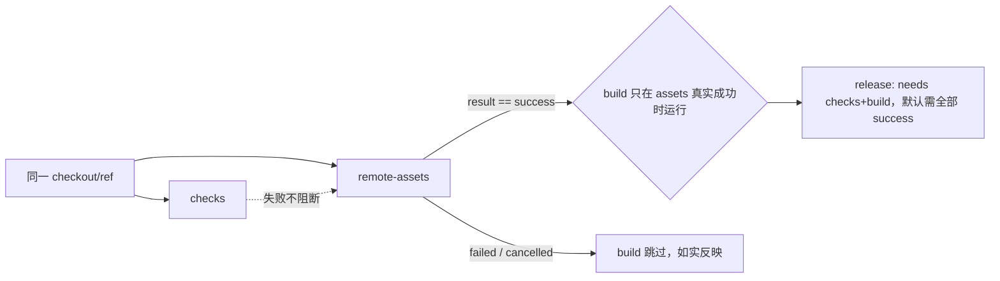

# Linux / Windows 桌面 CI 与草稿发布

## 范围与产品规则

- 构建矩阵覆盖 Linux x64/arm64、Windows x64/arm64、macOS arm64/x64；除 Windows arm64 在 x64 runner 上交叉打包外，均使用 GitHub 托管的**原生** runner（Linux arm64 用 `ubuntu-24.04-arm`）。
- PR、main 推送、手动运行和 `v*` 标签推送均执行检查与 Linux/Windows 打包；macOS 仅手动运行和标签推送构建（保持现有成本规则）。PR/main 仅构建 production / ZCodium Exp；手动与标签构建 production + preview / ZCodium Rust 两种身份，见下方双产品发布规则。
- Linux 沿用现有 AppImage、deb、rpm、pkg.tar.zst，Windows 沿用 NSIS exe，macOS 发 dmg 与 zip。
  本机缺 `rpmbuild` / `pacman` 时可用 `ZCODE_DESKTOP_LINUX_TARGETS=deb`（逗号分隔，取值限本次四种）只打子集；
  发布工作流不设置该变量，始终保持完整列表，未知取值直接失败而不是静默少出产物。
- 产物文件名遵循现有打包器的架构命名（`builder-util` 的 `getArtifactArchName`，按 target 名判定）：
  - deb：x64 → `amd64`，arm64 → `arm64`；
  - AppImage：x64 → `x86_64`，arm64 → `arm64`；
  - rpm：x64 → `x86_64`，arm64 → `aarch64`；
  - pacman（`pkg.tar.zst`）：x64 → `x64`，arm64 → `aarch64`。
- pacman 与 rpm 的 arm64 名是 `aarch64` 而 AppImage/deb 是 `arm64`：`getArtifactArchName` 只在 `pacman`/`rpm`/`flatpak` 三个 target 上把 arm64 改写为 `aarch64`，x64 不在其特例表里所以保持 `x64`。已由 linux arm64 构建实测确认四种格式的产物名。
- 同一架构族在不同格式里的写法不同，按 arch 筛选时必须归一（`ARCH_ALIASES`），否则 `x64` 匹配不到 deb/AppImage。
- 只有版本标签推送允许创建 GitHub **草稿** Release，公开发布由维护者审核后操作。
- 带预发布标识的版本同时标记为 prerelease，审核发布时不会被误当作稳定版本。
- 标签版本需满足 SemVer（可带预发布标识，不接受 build metadata）。保留 `validateTag(tag, baseline)` 的兼容行为：两参数仍精确校验 `v<baseline>`；可选第三参数 `expectedRollingVersion` 时，只有 `v<expectedRollingVersion>` 精确通过。滚动发行传入当前 checkout 的 `collectRollingAppVersion().appVersion`，不以任意日期/序号正则代替精确匹配。CLI `check-version` 与 `publish` 都直接派生当前值，不读构建缓存。
- 滚动版本串（`scripts/rolling-app-version.mjs` 的 `collectRollingAppVersion`）是 `mock-cdn/releases/<version>` 目录名、`manifest.appVersion` 与打包侧 `appInfo.version` 的唯一来源；三者在单次构建内必须同源。
- 依赖安装使用 frozen lockfile。Node 从 mise.toml、pnpm 从 package.json 读取；同步已有依赖遗漏的锁文件项，不升级业务依赖。
- 工具链读取器显式解析 mise.toml 的 tools 表，只接受固定版本，并验证 pnpm 与 packageManager 一致；缺失或不一致时在安装前失败。
- 构建只使用当前源码与仓库已有资源，不读取 references/，不需要官方账号、服务凭据、私有镜像或签名证书。
- 本 PR 不迁移技能、不新增 CUA 原生实现、不配置应用内自动更新；现有账号及遥测代码的全面移除另行实施。

## 所有者、接口与事件顺序

GitHub Actions 工作流拥有调度和权限；现有 `bundle:desktop` 拥有构建、运行时依赖验证与体积审计；发布脚本只拥有产物筛选、校验和及草稿上传，不复制业务状态。

版本串所有权：`prepare:runtime-assets` 必须在任何消费方读取版本前先落盘 `build-meta.json`（即先执行 `prepare:build-meta`，再执行 `prepare:remote-assets`）。`prepare:remote-assets` 把 `appVersion` 烧进 `bundled-remote-assets` 的 manifest，electron-builder 的 beforePack/afterPack 用 `context.packager.appInfo.version` 校验同一份 manifest；两侧都经 `getBuildMetadata()` 读同一份缓存，因此缓存刷新必须早于第一次读取。

构建阶段不重复执行：`bundle:desktop` 串联 `prepare:runtime-assets` 与构建脚本。`build` 自身以 `prepare:runtime-assets` 开头，因此显式准备过运行时资产后只能调用 `build:no-runtime-assets`；否则 `prepare:remote-assets`（实测约 42s）与 `prepare:agent-bundle`（实测约 31s）整段重复执行。`--skip-prepare` 的语义是「不单独跑准备阶段、交给 `build` 自己准备」，此时才调用完整的 `build`。



- 检查与构建仅 `contents: read`；仅标签发布 job 拥有 `contents: write`，token 只在上传步骤注入。
- checkout 不保留凭据；不使用 pull_request_target，不使用 PR 输入拼接 shell 命令。
- PR/main/手动运行仅上传 Actions artifacts；构建阶段显式禁止 electron-builder 自动发布。
- 同一 ref 的普通构建允许取消旧运行；标签发布串行且不取消在途运行。
- 发布仅消费当前 run 的固定 artifact。任何平台缺失、错误版本、空文件或额外文件均拒绝上传。
- SHA256SUMS 由最终下载后的文件生成。重跑仅可更新同标签草稿；已公开 Release 拒绝覆盖。
- Draft notes 第一段固定为用户指定 Shakespeare 引文及中文翻译/出处，其后含本次实际 features：Holes、mobile replayable realtime、scoped upstream 3.15.1 同步；注明人工验收未完成。保留 unsigned 与 SHA256SUMS 平台提示。创建前不得执行真实 tag 或 GitHub Release 写入。
- 发布 job 是 Release 的唯一写入者；失败不会自动发布。上传中断可能留下草稿，重跑覆盖同名草稿资产。

## 检查、远端资产与打包的 needs 图与失败语义

`checks`（coverage 型源码门禁）、`remote-assets`（真实构建并上传 Linux x64 远端运行时）、`build`（各平台打包）是相互独立的缺陷类，不能用一个 job 的 success 掩盖另一个：



- `remote-assets` 与 `checks` 没有产物依赖，必须从同一 ref 并行启动，不再等待 coverage 门禁结束；仍只按 `!cancelled()` 门禁。`checks` 失败（非取消）时仍要真实构建并上传资产，否则 `build` 只能拿到不存在的 artifact。取消 run 时不启动构建。
- `build` / `build-macos` 只 `needs: remote-assets`，用 `needs.remote-assets.result == 'success'` 而不等待/检查 `checks`：checks 红或仍在执行但 assets 成功时继续打包，保留「检查与打包独立」的产品规则；assets 失败或取消时跳过，避免四个平台各自重复报 artifact-not-found。
- 不引入 `continue-on-error`、`if-no-files-found: ignore` 或 artifact 静默 fallback；跳过/失败状态必须诚实可读。
- `release` 保持 `needs: [checks, build, build-macos]` 的默认全成功语义，`checks` 失败时绝不创建草稿。

## CI 关键路径与重复构建优化（实现前规则）

历史 main run `38209837838` 总计 24:48：Checks 约 9 分钟 → remote-assets 约 2 分钟 → 最慢平台约 13 分钟；PR run `38739244753` 还出现明显调度等待。Linux electron-builder 四种格式耗时约 9–10 分钟；注入 runtime modules 与 sourcemap 清理各重写一次 asar，合计约 40 秒。不能把整个耗时归因于 TS 编译。

本轮保持原有测试、六平台矩阵触发规则、Linux 四种安装包、签名、原生资源校验、取消/失败语义和草稿发布门禁；不通过删测试、少打包或降低压缩/验证换速度，不引入不完整构建缓存。

1. **调度唯一所有者为 workflow。** `checks` 与 remote producer 并行；平台 build 只依赖已验证的当前 run remote artifact；release 仍等待 checks 与所有 required builds 全部成功。不得复用其他 run 的 artifacts，也不把检查失败静默变成成功。
2. **远端单文件 bundle 唯一生产者为 `prepare:remote-assets`。** Server 的常规 `build` 默认仍编译 HTTP + remote；在已有 `ZCODE_SKIP_REMOTE_ASSETS=1` 的显式场景只编译 HTTP，不再隐式重建已由 producer 生成的 remote bundle。`build:remote` 直接调用仍无条件从源码构建。CI 必须保持下载 artifact → manifest/native 校验 → prepare/runtime → workspace build → package 的顺序；不根据旧 dist 文件存在跳过编译。
3. **已打包 asar 由一个最终化事务拥有。** 一次 extract → 补齐缺失 runtime 依赖 → 清理全部 sourcemap 注释/map（含新注入依赖）→ 有变更才 repack 一次。无变更不得重写；prepare/cleanup/repack 任一步失败则中止出包并清理 staging，继续使用现有候选 archive/native sidecar 替换与目标平台 unpack 规则。resources/unpacked/extraResources 的清理仍执行，runtime/native/版本边界校验仍位于最终化之后。
4. 各阶段继续输出计时，优化收益需用修复后真实 Actions job/step 时长比较；本机脚本测试不是完整安装包或 CI 墙钟验收。发行格式内部压缩的分钟级空档另行测量，不在未证明前改变格式或分拆共享打包目录。

```text
相同源码 ref ┬→ checks（原覆盖全部保留）───────────────────┐
             └→ remote producer → 当前 run artifact      │
                → 平台 manifest/native 校验              │
                → runtime + HTTP/workspace build          │
                → 单次 asar 最终化 + 原安装包/探针 ─────────┤
                                                        └→ release 全成功门禁
```

新增验收：

- 解析真实 workflow 断言上述 DAG，checks 未完成/失败均不能额外阻断 assets/build，assets 失败仍阻断 build，release 仍受 checks 约束；所有原测试命令、产物与安全权限保留。
- Server build 的默认/显式 skip/直接 remote 入口验证；HTTP 编译失败不得继续 remote，remote 失败不得写成成功。
- 用真实 asar fixture 覆盖依赖注入和 sourcemap 同时变化时只 extract/repack 一次、无变化零 repack、新注入 map 清理、native unpack、原资源清理，以及 staging 失败不替换原 archive。
- 执行定向与全套发布脚本测试、`pnpm typecheck`、`pnpm lint`、架构/格式/workflow 检查；推送后观察真实 CI，报告待完成或既有失败，不将其写成通过。

### 本轮本地验证

- 新 DAG 测试先红后绿；293 项发布脚本测试通过，包含真实 asar fixture 的注入/清理/零变更/native unpack/prepare 失败/清理失败/候选 pack 失败/资源链接兼容性回归。
- `ZCODE_ENV=production ZCODE_SKIP_REMOTE_ASSETS=1 pnpm build:bootstrap` 真实 workspace + Desktop 构建通过；普通 Server build（未设置 skip）及显式 skip 环境下的直接 `build:remote` 也实际执行成功，未用 mock 代替编译验证。
- CI 同款 Vitest 175 项通过；根 `pnpm typecheck`、`pnpm architecture:check --changed`、改动文件格式与 `git diff --check` 通过；`pnpm lint` 为 50 条存量 warning、0 errors。Actionlint v1.7.12 通过（v1.7.7 不认识现有 `macos-15-intel` label，未为旧工具改动 runner）。
- 本机 Node 为 24.19.0，仓库/CI 固定版本继续由 mise.toml 解析；独立 Desktop main 工程不在根 typecheck 内，本轮不宣称其全部错误已清理。
- 最近优化前 main run `38937514122`（`c8aeef2e`）总计 27:20，Checks 7:56、remote-assets 2:21、最慢平台 15:23，Linux arm64 的 package 步骤 12:15。推送后应与真实新 run 对比关键路径与 asar timer；不能把理论移除的串行等待写成已测墙钟收益。

## 验收场景

1. fork PR 无仓库写权限也能运行检查与全平台构建；不触发发布。
2. 各平台独立产生所有预期安装包，并通过已有 app.asar 运行时依赖校验。
3. 手动运行可下载各平台产物，标签上下文的手动运行仍不创建 Release。
4. 合法标签、全平台构建与检查全部成功后，只生成草稿及 SHA256SUMS；维护者仍须手动发布。
5. 版本不匹配、单平台失败、缺包、错版本和空包阻断发布；重跑不能覆盖公开 Release。baseline 两参 tag 校验保持兼容；滚动发行精确接受当前派生 tag，拒绝同格式但错误 date/count、旧/裸 baseline tag。
   5a. 在已有陈旧 `build-meta.json` 的工作区里，`bundle:desktop --os linux --arch x64` 不得因 `Bundled remote appVersion mismatch` 失败；烘焙出的 `manifest-linux-x64.json` 的 `appVersion` 必须等于当前 HEAD 算出的滚动版本。
6. 发布辅助脚本用临时目录和模拟 GitHub 调用测试，覆盖以上失败语义，不访问真实 Release。
7. Linux arm64 与 Linux x64 的产物按 arch 分别收集，互不覆盖；`deb`/`AppImage`/`rpm`/`pacman` 的 arm 架构名与 `builder-util` 的实际命名一致。
8. 原生 runner 上执行 CUA 原生库与打包后 Electron 运行时探针；交叉打包的架构只校验随包资产文件（`--files-only`）。
9. 执行 typecheck、lint、架构检查以及工作流语法验证；已有失败或环境限制如实记录，不降级门禁。

## 检查阶段的源码测试

Checks 中的诊断回归直接读取受检源码，不依赖 CLI package 的 `dist`、历史 bundle 或本地增量构建缓存。诊断测试入口共用独立 tsconfig，将需要的 `@zcode/contracts` 公共入口解析到契约源码，并保留 UI 的 `@/*` 源码别名；静态与测试执行时的动态导入使用同一配置。不修改生产 package exports，也不为测试加载整个 CLI 构建流程。

验收：隐藏全部 CLI workspace 构建输出后，使用与 CI 相同的 `node --test --test-isolation=none scripts/ci/*.test.mjs` 执行，必须实际加载全部诊断子用例；导入失败不能算作未执行的成功测试。

浏览器 smoke 的同步契约：断言必须等待 UI 可观察状态（例如菜单触发器 enabled），不能把偶然的 DOM 变化（例如 file input 被 `input.remove()`）当作状态已解锁的信号。`useConversationArchiveImport` 在取消/完成路径里由 `busyRef` + `setBusy` 解除 busy，React 提交发生在这类同步 DOM 清理之后，因此旧式「input 移除即解锁」断言会抢跑。等待真实状态仍保留取消零 `beginArchiveImport`、重复导入与 host generation stale guard 的断言。

## 发行边界

- 桌面、远端和首启 seed 清单保持一致，只分发源码资源完整且满足 seed 契约的插件，不降低资源校验要求。
- CUA 原生运行时按目标 platform/arch 落盘（`@trycua/cua-driver-<platform>-<arch>`），交叉打包不得把构建机架构的原生库带进安装包。
- Linux/Windows GUI 启动和安装体验需在真实目标环境验证；静态检查与脚本测试不能替代安装验收。

## 双产品发布与本地 deb 验收（实现前规则）

用户授权同一源码/滚动版本/tag 的一版发行同时包含两种产品：

- `production`：ZCodium Exp，`ZCODE_ENV=production` + `ZCODE_PREVIEW_IDENTITY=0`，默认 TS runtime。
- `preview`：ZCodium Rust，`ZCODE_ENV=production` + `ZCODE_PREVIEW_IDENTITY=1`，默认随包 Rust runtime；是实验身份，不是 test 后端。
- 身份来源仍为 `desktop-product-identity.mjs`；不在发布脚本另写产品名、appId、包名表，也不改用户数据路径或自动更新渠道。
- PR/main push 保留原有四格 Exp Linux/Windows 矩阵；手动和 tag 才展开双身份 Linux/Windows 及 macOS，共十二格。`fail-fast: false` 保留。
- 每格使用独立 checkout/prepare/build/package；不复用另一身份编译的 Main/preload/renderer。artifact 名固定为 `desktop-<flavor>-<platform>-<arch>`，单格 collect 仍仅收自己的身份/平台/架构。
- remote producer 仍只有一个，两个身份复用同 run、同版本的真实 remote artifact；两个身份后端环境相同。不引入跨 run 缓存产物或缺失 fallback。
- Preview job 在 prepare 之前安装明确目标的 Rust 工具链。Windows ARM64 继续现有 x64 runner 交叉打包，额外明确初始化 ARM64 MSVC 工具环境和 Rust target；不能把 host x64 binary 当目标 binary 打包。
- tag release 仍需 `checks`、整个 `build` 与 `build-macos` 全成功。明确下载十二个当前 run 的固定 artifact，先验证两种身份全部 28 个安装包，再生成一份覆盖全部文件的 `SHA256SUMS`；缺任何身份/架构/格式、空文件、错版本、额外文件均失败。
- 同一 Draft Release 标题/说明明确 Exp=TS、Rust=实验 Rust；重跑已有草稿也先同步这些自动生成的元数据，不能缺少双产品说明；保留已有人工备注和自动变更日志，缺少产品说明时补充而不是重置正文。元数据更新失败不继续上传；已公开 Release 仍在任何编辑前拒绝。保留既有 Shakespeare 首段、unsigned/未完成全平台人工验收提示、tag 精确版本验证、已公开 Release 禁止覆盖和仅 draft 可重跑规则。
- 手动触发仍只产出 artifacts，不创建 Release。双包失败不得静默生成半套发行。

```text
同一 ref / version ┬→ checks ──────────────────────────────────┐
                   └→ 一个 remote producer → 当前 run artifact │
                      ├→ Exp 平台格 → 独立身份/产物 ───────────┤
                      └→ Rust 平台格 → Rust target/资产/产物 ──┤
                                                              v
              仅 tag + 所有必需格成功 → 28 包精确校验 → SHA256SUMS
                                                              v
                                      同一个 Draft → 维护者人工公开
```

### 本次验证边界与验收

1. 解析真实 workflow 验证事件→身份笛卡尔积、原平台/格式/覆盖命令、安全权限/needs 图不退化、Rust target 与 MSVC ARM64 设置、artifact 名及十二个下载完整且唯一；不得只测手写副本。
2. 发布脚本临时 fixture 覆盖两身份文件名不冲突、按身份 collect、完整 28 包与哈希、缺一个身份/单文件/空包/错版本/额外包拒绝、旧单身份 helper 调用兼容、draft-only 与无副作用失败。
3. 本地在固定 Node 下从本轮源码分别 prepare/build/package 两个 Linux x64 deb，仅用已有 `ZCODE_DESKTOP_LINUX_TARGETS=deb` 本地子集开关，输出到不同目录；不降低 CI 的完整格式要求。检查包名、版本、架构、appId/资源及 runtime 身份。
4. 在临时目录解包真实 deb，直接启动其携带的可执行文件，断言 `app.isPackaged=true`、app/resources 路径属于该 deb。分别使用独立临时 HOME/userData/sessionData/XDG/数据根及本地 OpenAI-compatible fixture；删除 runtime override，证明产品默认确实选择随包 TS/Rust（不能用开发 Cargo binary 冒充）。
5. 通过真实 GUI/composer 验证数据库 ready、模型文本、文件工具结果、退出后同数据目录重启恢复，再追问并核对模型收到旧轮历史。使用测试目录内文件及 fixture key；不读取已有用户配置/凭据/会话/日志、不调用真实模型，不全局 kill 或卸载系统现有程序。
6. 普通发行构建不启用 E2E store bridge；测试可以复用既有 Playwright main 观察/网络隔离和真实 DOM 操作，不改变产品默认值来让测试通过。实际受限或失败时报告阶段与证据，不能把 deb 文件存在或静态资源校验等同于可用性。
7. 本地解包启动不是系统级 `dpkg -i` 安装/桌面注册验收；本轮不承诺其他架构、Windows/macOS、真实模型、Rust 全功能和既有历史库迁移已通过。
8. **用户补充限制：本轮仅本地修改/打包/验证，不 push、不打 tag、不创建/上传真实 Release，不公开任何安装包。** 发布 API 只使用 mock 测试。
9. 实际执行定向测试、根 typecheck/lint、架构与格式检查；保留无关 `logs/`。发布规则改动与本地测试结果分别报告。

### 本轮本地实测记录（未公开）

- 源码基线 `d988d893`，CI/测试改动仍在本地工作区；Node 24.14.0，Linux x64。
- 从当前源码依次完整 prepare/build/package 两种身份，远端资产只首次重建，第二种复用同版本产物；仅本地使用 `ZCODE_DESKTOP_LINUX_TARGETS=deb`，未修改 CI 的全格式列表。
- 两个 App 均为 `3.15.1-20261018.374`；deb control 均为 `3.15.1~20261018.374`（fpm 的 Debian prerelease 表达）。验收精确比对当前源码派生版本、deb control 与启动后 `app.getVersion()`，错版本不能通过。
- 实际加载两种构建环境的 electron-builder 配置，appId 分别为 `dev.zcodium.app.exp` / `dev.zcodium.app.preview`，productName/executable 与既有 identity 完全一致；Linux 运行期不伪造不存在的 appId API，另验真实产品名/包身份与资源。
- Exp：`zcodium-exp` / amd64，231.45 MiB；Rust：`zcodium-rust` / amd64，242.15 MiB。路径为 `/tmp/zcodium-dual-deb/production/` 与 `/tmp/zcodium-dual-deb/preview/`。
- 在临时解包根和独立 Xvfb 中运行真实 deb 内的 executable，未执行系统 `dpkg -i`。两者 `app.isPackaged=true`、产品名分别为 ZCodium Exp / ZCodium Rust，app/resources 路径均属于各自 deb。
- Exp 的 TS CLI 会改写 process.title，不能仅依赖 argv 路径；验证自有 PID 的 packaged Electron executable、Node mode、Main 下发的 `ts` 选择与非空随包 JS bundle。Rust 同时核对自有 PID 的 argv 和 `/proc/PID/exe` 指向 deb 内 `resources/rust/zcode-cli-rust`，不使用开发 Cargo binary。Linux 进程发现覆盖自有进程的全部线程 children，不扫描其他用户进程。
- 两种身份都通过真实 GUI 输入、本地 fixture 模型响应、Read note.txt 的 marker 回传模型后 UI 完成、同数据根重启恢复，以及重启后继续对话并确认请求携带先前用户轮历史。未启用构建期 E2E store bridge，无 runtime override；各自独立临时 HOME/XDG/userData/sessionData/业务库，无环境凭据泄漏。
- 实测 JSON、进程与版本证据及 App 窗口截图仅落在 `/tmp/zcodium-dual-deb/{production,preview}-smoke.json` 及对应 `.png`，未上传。Chromium 的非本地流量由代理/拦截阻断；不宣称任意 Node 直接 socket 已被 OS 网络隔离。
- 此证据仅表示 Linux x64 新数据目录的基本可用性；不等于系统安装/桌面注册、旧库迁移、同库并行、真实模型或其他平台验收，也不证明 Rust 所有功能与 TS 完全一致。
- 没有 push、tag、真实 Release 写入或公开安装包；用户现有 `logs/` 未修改。

## 参考

- [setup-node](https://github.com/actions/setup-node)：按 mise.toml 安装 Node。
- [pnpm/action-setup](https://github.com/pnpm/action-setup)：按 packageManager 安装 pnpm。
- [upload-artifact](https://github.com/actions/upload-artifact) / [download-artifact](https://github.com/actions/download-artifact)：同一工作流内传递产物。
